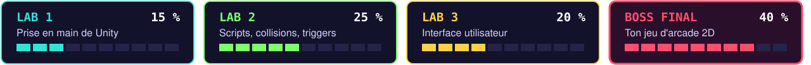
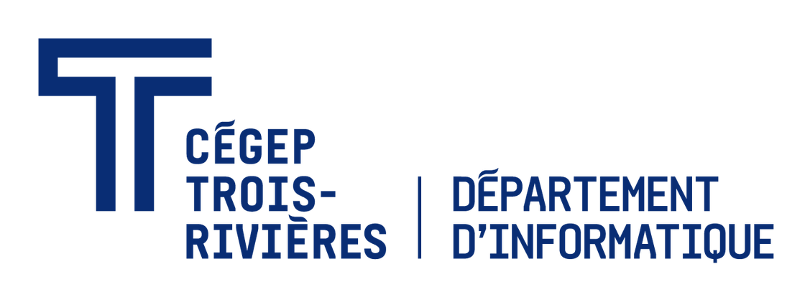

**Cette session, tu passes de joueur à développeur.** 🎮
Avec **Unity** et **C#**, tu vas construire des mondes en 2D et en 3D, puis leur donner vie : physique, collisions, interface, manettes, multijoueur, particules, animations et son. Tu exporteras ensuite tes jeux pour le Web, le PC et la réalité virtuelle. Le boss final : **ton propre jeu d'arcade 2D, du premier sprite jusqu'à l'écran de fin.**

<b>🗺️ Voir le détail des niveaux</b>

 

| Monde | Semaines | Ce que tu débloques |
|:---:|:---:|---|
| **1-1 · Moteur et outils** | 1 | Unity, ergonomie de l'interface d'un jeu, comparaison des moteurs de jeu, outils de codage et de débogage |
| **1-2 · Mondes 2D et 3D** | 2 à 5 | Logiciels de création 2D et 3D, adaptation des images au projet, résolution selon la plateforme, ancrages pour s'adapter à tous les écrans |
| **1-3 · Logique de jeu** | 6 à 9 | Programmation de l'interface utilisateur, interactions avec la physique, les vecteurs et les contrôles, collisions entre les éléments du jeu |
| **1-4 · Contrôles et réseau** | 10 et 11 | Souris, clavier, manettes, réalité virtuelle ou mixte, objets connectés, jeux à plusieurs joueurs et en réseau |
| **1-5 · Effets visuels** | 12 et 13 | Systèmes de particules, animations à partir de sprites et de sprite sheets, transitions d'animation, post-traitement |
| **1-6 · Son** | 14 | Formats et compression, trame sonore en boucle, édition des effets sonores, déclenchement par le code, son 2D ou 3D |
| **1-7 · International** | 15 | Normes de publication sur les plateformes de vente en ligne, adaptation du jeu à d'autres langues et cultures |

<b>🏆 Voir le détail des missions</b>

 

| | Mission | Objectif | Pondération |
|:---:|---|---|:---:|
| 🧱 | **Lab 1** | Prise en main de Unity et mise en place d'éléments graphiques dans une scène 3D | **15 %** |
| 💥 | **Lab 2** | Projet 3D avec des scripts interactifs en C#, des collisions et des déclencheurs (triggers) | **25 %** |
| 🎛️ | **Lab 3** | Conception et programmation de l'interface utilisateur (UI) | **20 %** |
| 👾 | **Boss final** | Le projet synthèse : un jeu d'arcade 2D complet qui réunit toutes les notions de la session | **40 %** |

**IA générative : niveau 2 (utilisation encadrée)** pour toutes les missions. Tu peux t'en servir seulement pour les tâches permises dans les consignes, et tu dois déclarer ton utilisation.

<b>🕹️ Prêt·e à jouer? Les installations</b>

 

1. 🧰 Installe [**Unity Hub**](https://unity.com/download), puis l'éditeur Unity.
2. 💻 Installe [**Visual Studio Community**](https://visualstudio.microsoft.com/fr/vs/community/) avec la charge de travail *Développement de jeux avec Unity*.
3. 🐙 Installe [**GitHub Desktop**](https://desktop.github.com/) et connecte-toi avec ton compte GitHub.
4. 📥 Choisis un dépôt plus bas, clone-le ou clique sur **Use this template** pour créer ta copie, puis ouvre-le dans Unity Hub avec **Add project from disk**.

 

### 👇 Les dépôts du cours sont juste en dessous

Ou vois-les tous dans l'onglet [**Repositories**](https://github.com/orgs/Cours-Jeu-Video-CegepTR/repositories)

  

<a href="https://www.cegeptr.qc.ca">
<picture>
  <source media="(prefers-color-scheme: dark)" srcset="assets/logo-info-blanc.png">
  
</picture>
</a>

**Dave Lacourse** · Local SB0050 · Fait avec ☕, C# et quelques *Game Over*

